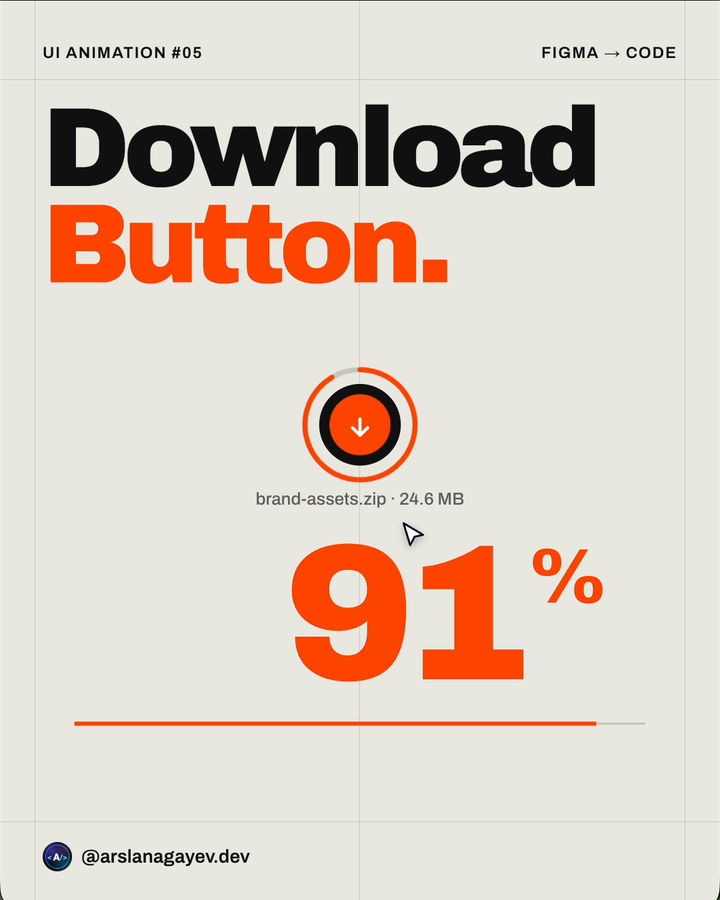

# Download Button

A Swiss-style download button: the pill collapses into a circle, an orange progress ring draws around it while a giant counter ticks to **100%**, then the circle turns orange, a check draws itself and the pill springs back as **Downloaded**.



**[Live demo](https://arslanagayev.github.io/download-button-animation/)** · **[Reel mode](https://arslanagayev.github.io/download-button-animation/?reel)** · **[Figma file](https://www.figma.com/design/WIxy4pyOOsibfsuUIUq12B)** · UI animation #05 of a weekly series on Instagram [@arslanagayev.dev](https://www.instagram.com/arslanagayev.dev/)

Designed and animated in **Figma** (Motion keyframes), then built in plain **HTML, CSS and JavaScript**: no frameworks, no build step, no dependencies. Click **Download**, then click **Downloaded** to reset.

## How it works

1. On click the pill presses in, the label slides out and the pill's `width` animates down to its height, so it becomes a circle. The arrow icon is anchored to the right edge, which means it lands in the centre on its own.
2. One progress value drives three things: the ring (`stroke-dashoffset` on an SVG circle), the giant counter and the progress rule along the bottom. The arrow bobs while it downloads.
3. At 100% the circle turns orange, the ring pulses outwards and fades, and the check mark draws itself.
4. The pill springs back to full width with a slight overshoot while the check and **Downloaded** settle side by side.

## Features

- Swiss look: off-white paper, ink black, one signal orange, a thin grid and heavy grotesque type. Fonts: Archivo + Archivo Black
- Motion from the Figma prototype translated to the Web Animations API (`element.animate`) with matching easing curves
- Real `<button>`, an `aria-live` status message and `prefers-reduced-motion` support

## The key code

```js
// One progress value drives three things
function setProgress(p) {
  bar.style.strokeDashoffset = `${CIRC * (1 - p)}`;
  num.textContent = String(Math.round(p * 100));
  line.style.setProperty('--p', p.toFixed(4));
}

// Collapse the pill into a circle...
await button.animate(
  [{ width: `${w}px` }, { width: `${h}px` }],
  { duration: 480, easing: SMOOTH, fill: 'forwards' },
).finished;
```

## Use it in your project

Copy `index.html`, `style.css` and `script.js`. The component itself has no dependencies; the `reel/` folder is only used by the reel mode described below. To drop it, delete the `mountReel(...)` call at the end of `script.js` and its import on the first line (keep `sleep`: `const sleep = (ms) => new Promise((r) => setTimeout(r, ms));`).

## Reel mode

Add `?reel` to the URL and the page becomes a self-playing 1080×1920 video stage: a title, the animation driven by a scripted cursor, a code excerpt and an end card, on a loop. Open it on a phone and use the built-in screen recorder to get an Instagram reel. `?autoplay` loops the scripted demo without the frame.

Options:

- `?reel&ratio=4x5`: a 1080×1350 stage for Instagram carousel videos
- `?reel&nocode`: hide the code excerpt
- `?reel&delay=3000`: wait 3 seconds before the first run (time to start the recorder)

## Run locally

ES modules don't load from `file://`, so serve the folder:

```bash
git clone https://github.com/arslanagayev/download-button-animation.git
cd download-button-animation
python3 -m http.server 8080   # then open http://localhost:8080
```

## License

[MIT](LICENSE) © 2026 Arslan Agayev
